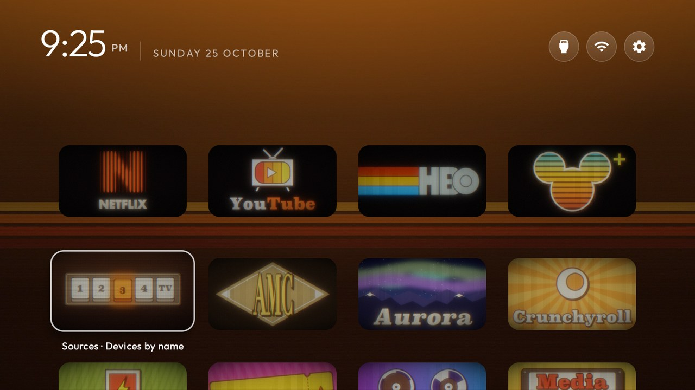

# Retro 70s tiles for cleanyourtv

A 70s CRT look for the [cleanyourtv](https://github.com/Gathin23/cleanyourtv) launcher: hand-drawn retro tile art for
popular TV apps, with a phosphor glow, scan lines and grain on every tile, and a warm amber, sunset-striped wallpaper.



## What's here

| Folder | Contents |
| --- | --- |
| `tiles/` | 25 tile banners (`banner_retro_*.png`, 708x396), including alternate designs for several apps |
| `theme/` | A cleanyourtv theme: `config.json` plus the amber wallpaper |
| `wallpapers/` | Other 1920x1080 wallpapers: plain sunset stripes, wood panelling, a sunburst |
| `generator/` | The Python scripts that draw the tiles and wallpapers, if you want to change or add to them |
| `install.sh` | Copies the tiles into your launcher, rebuilds it and pushes the theme in one step |

## Before you start

You need cleanyourtv already set up for your TV: a checkout of the repo, its `tools/venv`, network ADB working, and
`launcher/build-and-install.sh` having worked at least once (so Java 17 and the Android SDK are in place). If you have
not done that yet, follow the cleanyourtv README first.

## Install

```bash
git clone https://github.com/michaelhalstead/cleanyourtv-retro70s
TV_HOST=192.168.1.50 cleanyourtv-retro70s/install.sh path/to/cleanyourtv
```

Use your TV's IP address. On a Mac, add `JAVA_HOME=$(/usr/libexec/java_home -v 17)` before `TV_HOST` if Java 17 is
not your default.

### Doing it by hand

Tile art has to be built into the launcher APK; a theme can only point at drawables the APK already has. So there
are two parts:

1. Copy the tiles into the launcher and rebuild it:

   ```bash
   cp tiles/banner_retro_*.png path/to/cleanyourtv/launcher/app/src/main/res/drawable-nodpi/
   TV_HOST=192.168.1.50 path/to/cleanyourtv/launcher/build-and-install.sh
   ```

2. Push the theme:

   ```bash
   TV_HOST=192.168.1.50 path/to/cleanyourtv/tools/theme.sh theme
   ```

Press Home on the remote to see it.

## Which tile goes on which app

`theme/config.json` maps apps to tiles under `app_banners`, one `"package=banner_name"` line each. Apps you don't have
are ignored. The defaults:

| App | Package | Tile | Alternates |
| --- | --- | --- | --- |
| Netflix | `com.netflix.ninja` | `banner_retro_netflix_lines` | `netflix`, `netflix_bow`, `netflix_stripe` |
| YouTube (SmartTube) | `org.smarttube.stable` | `banner_retro_youtube_tv` | `youtube` |
| HBO Max | `com.wbd.stream` | `banner_retro_hbomax` | |
| Disney+ | `com.disney.disneyplus` | `banner_retro_disney_slat` | `disney`, `disney_teal` |
| AMC+ | `com.amcplus.amcandroidtv` | `banner_retro_amc_diamond` | `amc` |
| Prime Video | `com.amazon.amazonvideo.livingroom` | `banner_retro_prime_echo` | `prime` |
| Paramount+ | `com.cbs.ott` | `banner_retro_paramount` | |
| Peacock | `com.peacocktv.peacockandroid` | `banner_retro_peacock` | |
| Crunchyroll | `com.crunchyroll.crunchyroid` | `banner_retro_crunchyroll` | |
| Fandango at Home | `air.com.vudu.air.DownloaderTablet` | `banner_retro_fandango` | |
| Jellyfin | `org.jellyfin.androidtv` | `banner_retro_jellyfin` | |
| Aurora Store | `com.aurora.store` | `banner_retro_aurora` | |
| Play Store | `com.android.vending` | `banner_retro_play` | |
| Settings | `com.android.tv.settings` | `banner_retro_settings` | |
| Sources add-on | `io.github.maxhayim.sources` | `banner_retro_sources` | |
| Media (Hisense) | `com.jamdeo.tv.mediacenter` | `banner_retro_media` | |
| Protector (Hisense) | `com.hisense.tv.protector` | `banner_retro_protector` | |

If you use the official YouTube app, change `org.smarttube.stable` to `com.google.android.youtube.tv`.

To use an alternate, change the tile name on that app's line and push the theme again. No rebuild is needed, because
every tile is already in the APK. To give one of these tiles to a different app, add a line with that app's package:

```bash
TV_HOST=192.168.1.50 path/to/cleanyourtv/tools/venv/bin/python -I path/to/cleanyourtv/tools/tv.py "pm list packages"
```

## Theme settings

The theme turns off the dock band, glass and big title so the tiles sit straight on the wallpaper, and uses a thin
rim for focus. It also sets:

- `wallpaper_true_color: true`, so the dark gradients don't band. This uses about 8 MB more memory; set it to `false`
  on a TV with less than 2 GB of RAM.
- `ambient_glow: false`. The amber glow is part of the wallpaper itself, so the background stays the same whichever
  tile is focused. Set it to `true` if you'd rather the top of the screen take on each tile's colour.
- `icon_only_buttons` and `icon_only_inputs`, so the top bar shows round icons only.

The keys are documented in cleanyourtv's `themes/README.md`.

On a Hisense set whose stock launcher you disabled, also add `"handle_view_inputs": true` so the remote's Input
button opens the launcher's Inputs menu.

## Other wallpapers

Copy any file from `wallpapers/` over `theme/wallpaper.jpg` and push the theme again:

- `amber-glow.jpg`: the default.
- `sunset-stripes.jpg`: the same stripes without the amber glow at the top. Pair it with `ambient_glow: true`.
- `wood.jpg`: walnut panelling.
- `sunburst.jpg`: an orange sunburst.

## Making your own tiles

`generator/make_tiles.py` draws every tile from code (Pillow and NumPy), then runs it through the CRT pass:

```bash
python3 -m venv venv && venv/bin/pip install pillow numpy
venv/bin/python generator/make_tiles.py out netflix_lines sources   # or no names for all of them
```

Each tile is a function registered in `LOGOS`. Copy one as a starting point, then copy the PNG into `tiles/` and add
an `app_banners` line. The fonts are macOS system fonts from `/System/Library/Fonts/Supplemental/` (SuperClarendon,
Futura, Didot, Snell Roundhand, Arial Rounded Bold). On another system, point `SUP` at a folder holding those fonts or
swap in your own.

Some tips from making these:

- Big areas of pure white bloom into a blur on a CRT. Use cream or light grey.
- Thin strokes vanish under the scan lines. Thicken them with an outline in the same colour.
- Closely spaced lines fill in. Keep about 13 lines across a 500-pixel shape.

`generator/make_wallpapers.py tiles out` draws the stripes, wood and sunburst wallpapers, plus a mock home screen for
each.

## Undo

- Back to the launcher's built-in look: `TV_HOST=... path/to/cleanyourtv/tools/theme.sh --reset`.
- To take the tiles out of the launcher as well, delete `banner_retro_*.png` from
  `launcher/app/src/main/res/drawable-nodpi/` and run `build-and-install.sh` again. Leaving them in is harmless.

## Trademarks

The tiles are fan-made retro reinterpretations of app logos, for personalising your own TV. The names and logos belong
to their owners; this project is not affiliated with or endorsed by any of them.

## License

The code is MIT; see `LICENSE`. The licence covers the scripts and original artwork, not the trademarks above.
